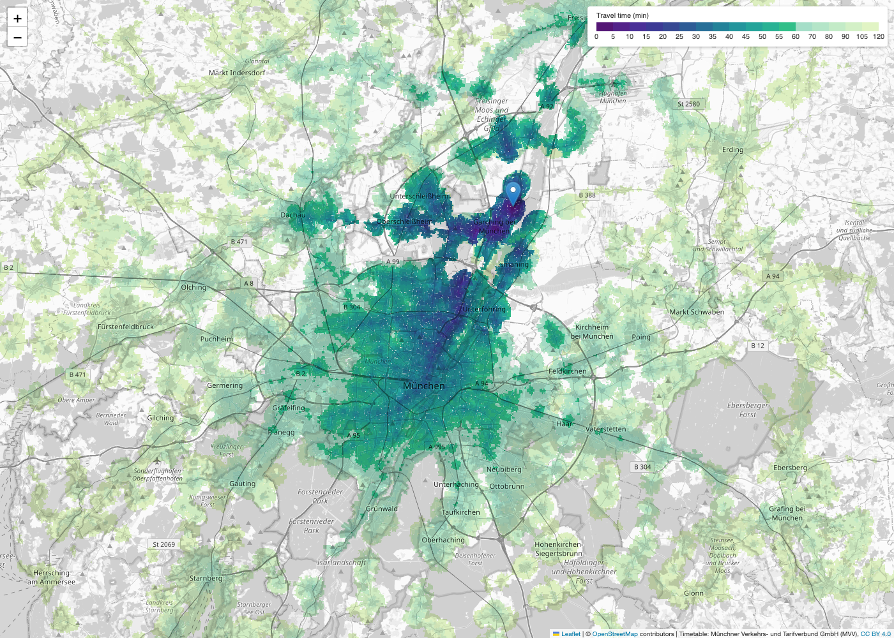

# Reverse isochrones for Munich public transport

Pick a destination in Munich and the time you need to be there. For every 100 m cell within
walking distance of a stop, this project computes the latest time you can leave and still arrive
on time by public transport and on foot, and draws the result as a map.



*Minutes needed to reach TUM Garching-Forschungszentrum by 9:00 on Wednesday, 9 December 2026.
Bands are 5 minutes wide up to one hour.*

[Open the interactive map](https://francescocodeca.github.io/munich-transit-reverse-isochrone/garching_2026-12-09_0900.html),
or [see all maps](https://francescocodeca.github.io/munich-transit-reverse-isochrone/) (TUM
main campus, TUM Ottobrunn, Olympia-Schwimmhalle, and Garching on a
[typical day](https://francescocodeca.github.io/munich-transit-reverse-isochrone/garching_2026-12-09_0900_w60.html)
around 9:00).

## The problem

A public transport network is not a static graph. A ride from stop u to stop v exists only when
a vehicle actually leaves u, so the cost of an edge depends on the time you reach u: if the bus
has just gone, you wait for the next one, or there is no next one. Dijkstra's algorithm with fixed
edge weights cannot express this.

The question is also asked backwards. The usual question is "where can I get to if I leave now?"
(earliest arrival). Here it is "from where, and how late, can I leave to reach D by time T?"
This is the latest departure problem. It is the mirror image of earliest arrival: instead of
moving forward in time from a fixed departure, the timetable is scanned backwards from the fixed
arrival T. A single backward scan gives the answer for every stop at once, so one run covers the
whole map.

## Method

The pipeline has five steps, each in its own module under `src/isochrone/`, and an optional
sixth that repeats the scan over a window of arrival times.

### 1. Connections from the timetable (`connections.py`)

The timetable is the MVV GTFS feed, which covers every mode of the Munich transport association:
regional trains, S-Bahn, U-Bahn, tram and bus. For the chosen service day, each trip is cut into
elementary connections: one vehicle going from one stop to the next, with a departure and an
arrival time. On 9 December 2026 this gives 769,125 connections from 41,788 trips.

- Stops are individual platforms, not stations: the cost of changing depends on which two
  platforms are involved (next step).
- Times are seconds after midnight of the service day. GTFS times past 24:00 (e.g. 25:10) are
  kept as they are, so sorting by time stays correct across midnight.
- Stops where a trip does not let passengers board or alight are kept as flags on the connection.
- On-demand buses (FLEXlinie), which run only when booked in advance, are left out by default.

### 2. Transfers between platforms (`transfers.py`)

The feed has no `transfers.txt`, so transfer times are modelled. A transfer is a walking edge
from one platform to another, with a fixed duration:

- same platform: 2 minutes (times in the feed are rounded to the minute, so this guarantees at
  least one real minute);
- two different platforms: straight-line distance × 1.3 at 1 m/s, plus a 70-second margin for
  getting off, stairs and finding the way, and never less than 2 minutes.

Platforms of the same station are always linked; platforms of different stations are linked if
they are within 400 m in a straight line, because one station in the feed does not always group
everything at the same place (e.g. Marienplatz has two). This gives 83,970 edges between
different platforms, found with a k-d tree on UTM coordinates (EPSG:25832) instead of comparing
all 355 million pairs. The 70-second margin was calibrated on nine transfers checked in the MVV
journey planner (see [Validation](#validation)).

### 3. Reverse Connection Scan (`csa.py`)

The core is a backward version of the Connection Scan Algorithm
([Dibbelt et al., 2013](https://doi.org/10.1007/978-3-642-38527-8_6)), written from scratch.
Connections are sorted by departure time and scanned once, from the latest to the earliest. Each
platform s keeps two values:

- `A[s]`: the latest time one can be at s and still reach the destination in time;
- `B[s]`: the latest departure from s (the result).

Each trip keeps one flag: whether staying on it reaches the destination in time. A connection
u → v of trip t is useful if that flag is already set, or if one can alight at v by `A[v]`. If
it is useful, the flag of t is set, `B[u]` becomes its departure time, and every transfer w → u
of duration f updates `A[w]` to at most `departure − f`.

Because connections come in decreasing order of departure, the first useful connection from a
platform fixes `B[u]` for good, and its incoming transfers are relaxed only once. This plays the
role of the priority queue in Dijkstra: the order of the scan, not a heap, decides when a value
is final. After sorting, a scan is linear in the number of connections plus transfers. A
2-hour window for a 9:00 arrival takes about 0.03 s in pure Python.

The destination D can be any point, not just a stop. Every platform within walking distance of D
becomes a target, with `A[s] = T − walk(s → D)`, so a single scan serves the whole map. Ties are
broken by stop sequence: connections of the same trip with the same departure minute are scanned
from the last stop backwards, so that the trip flag is set before it is needed.

### 4. Walking on the street network (`osm.py`)

The first and last legs of a journey are walked on the OpenStreetMap pedestrian network for
Upper Bavaria (Geofabrik extract), read with pyosmium into a graph of 5.2 million nodes. A way is
walkable according to its `highway` type (defaults from the OSM wiki table for Germany) and then
its explicit `foot`, `access` and `motorroad` tags. Each point is attached to the nearest node of
the main connected component, and distances are computed with Dijkstra
(`scipy.sparse.csgraph`), from whichever side has fewer sources.

The latest departure from a grid cell p is then

    departure(p) = max( max over platforms s of [B[s] − walk(p → s)],  T − walk(p → D) )

where the inner maximum runs over the platforms within 1300 m of p on the network (about
22 minutes at 1 m/s, a limit on how far one is willing to walk to a stop), and the last term is
walking all the way to D, allowed up to the 2-hour limit of the whole trip. Walking at 1 m/s
matches the default of r5py.

The same model was first built with straight-line distances × 1.3. Measured on the network, the
ratio between walking and straight-line distance has a median of 1.31, but the network still
matters: the maximum over many candidate platforms picks the favourable errors of the straight
line, so for Garching 9.6% of the cells depart more than 5 minutes earlier with the network.

### 5. Grid and map (`walking.py`, `maps.py`)

The map is a grid of 100 m square cells in UTM coordinates, built once for all destinations and
times. Only cells within 1000 m of a platform are kept (the area served by public transport),
cut to the boundary of the OpenStreetMap extract: 724,685 cells. For Garching at 9:00, 229,765
of them can reach the destination within 2 hours.

Cells are grouped into 17 bands of travel time (5 minutes up to one hour, then 10 and 15
minutes up to two hours), and the cells of each band are merged into one polygon with shapely.
The polygons are drawn with folium on a grey OpenStreetMap base, blended in multiply mode so
that streets and labels stay readable under the colours. One polygon per band keeps the page at
a few megabytes; one shape per cell would be 16–40 MB and slow in the browser.

### 6. Window of arrival times (`make_map.py`)

A map for one arrival time answers "I must be there at 9:00 sharp", and the answer can change
from one minute to the next: if the last line before D runs every 5 minutes, arriving by 8:58
instead of 9:00 can mean taking the previous train. For questions such as where to live, the
typical travel time around 9:00 matters more.

With `--window 60`, the scan is repeated for every minute from 8:30 to 9:30 (61 arrival times)
and each cell shows its median travel time. A minute in which a cell cannot arrive within
2 hours counts as an infinitely long journey, so a cell is on the map only if it arrives in more
than half of the minutes. The walks from the destination do not depend on the arrival time and
are computed once; each extra minute costs one scan and one maximum over the access legs (about
0.4 s), so the whole window adds about 25 seconds.

For Garching, on the 199,081 cells present in both maps:

- 57.6% stay in the same band, 28.3% move one band slower, 10.2% one band faster, and 3.9% two
  or more bands.
- The median cell takes 2 minutes longer than at 9:00. The 9:00 map is not wrong at random:
  almost every journey ends on the U6, which reaches Garching-Forschungszentrum at 8:59, so
  9:00 is a lucky minute for all of them at once.
- Single places move more. Dachau takes 55 minutes at 9:00 but 65 on a typical arrival; for
  Freising, where 9:00 falls badly for its trains and buses, it is the other way round (49 and
  40 minutes).

The window should be at least as long as the gap between departures of the lines used,
otherwise the median depends on where the window falls: with a 20-minute window, 31.5% of the
cells differ by 5 minutes or more from the 60-minute one.

## Validation

The model was checked against two independent references, both for a 9:00 arrival on
9 December 2026.

**MVV journey planner.** The quantity compared is the departure of the first vehicle, which is
what the planner shows, not the total time, which depends on where the origin point is placed.

- Calibration: the transfer margin was chosen from nine transfers looked up in the planner. Each
  accepted or rejected transfer is a linear constraint on the margin. Six were accepted (margin
  at most 41–113 s) and three rejected (margin above 34–64 s), so no single value satisfies all
  nine: 70 s satisfies six, and the three it gets wrong are all pessimistic.
- Six trips to Garching (used to tune the margin): 6 out of 6 board the same vehicle as the
  planner.
- Five trips to TUM, Arcisstraße 21 (not used for tuning): 2 out of 5 match; the other three leave
  2–5 minutes too late. Two of them change between lines that are stacked on top of each other
  underground (Sendlinger Tor, Hauptbahnhof), where the straight-line distance is almost zero but
  the real walk takes stairs and corridors.

**r5py.** [r5py](https://r5py.readthedocs.io/) (R5 routing engine) computes travel times from the
same GTFS feed and OSM extract. It routes by departure time only, so the latest departure was
rebuilt from 121 runs, one per minute from 7:00 to 9:00, on a random sample of 1,250 cells (1,000
reached by our map, 250 not); 952 are reached by both.

- 73.9% of the cells are within ±1 minute. The median difference is 1 minute in our favour,
  because R5 requires 60 seconds between reaching a stop and boarding, also at the first stop.
- 48 cells (5.0%) leave more than 5 minutes earlier with our model. 43 of them are explained by
  the access radius: R5 has no separate walking limit and walks up to about 2 km to a better
  line, our model stops at 1300 m.
- 30 cells (3.2%) leave more than 5 minutes later with our model, mostly through transfers that
  R5 accepts and our margin rejects, or the reverse. In the three cases checked in the MVV
  planner, the planner agreed with our model.

## Limitations

The map is meant as an indication: errors of a few minutes are expected, and a border between
two 5-minute bands can move by one band.

**Data**
- Planned timetables only, no real-time delays or cancellations. Construction work announced after
  the feed was published is missing.
- One service day: trips of the previous day running past midnight are not included. This does
  not matter for morning arrivals, but would for arrivals between midnight and about 6:00.
- On-demand buses are recognised by their trip ID, a heuristic specific to the MVV feed.

**Transfers**
- Walking times inside large underground stations are underestimated where lines are stacked on
  top of each other (straight-line distance close to zero): departures there can be 2–5 minutes
  too optimistic.
- No single transfer margin agrees with every transfer checked in the MVV planner (see
  Validation).
- A transfer uses a single walking edge: walking A → B → C between three nearby stations is
  found only if A and C are themselves linked.

**Walking legs**
- Access to and from stops is limited to 1300 m on the network, with no extra time for stairs to
  underground platforms.
- Points are attached to the nearest node of the street network, not to the nearest street
  segment, which slightly overestimates walking distances.
- Only cells within 1000 m of a platform are on the map: if the destination is far from any
  stop, cells that could reach it only on foot are missing.

**Map**
- The result is for one service day. A single arrival time can be a lucky or unlucky minute for
  the lines near the destination; the median over a window (`--window`) removes most of this
  effect, but a window longer than one hour mixes peak and off-peak timetables.
- The grid ends at the boundary of the Upper Bavaria extract (about 38 km from the centre in some
  directions).

## Repository and usage

```
src/isochrone/   reusable code: download, GTFS reading, connections, transfers, CSA,
                 walking (straight line and OSM), maps, r5py comparison, map command
notebooks/       exploration and validation, in order (01 GTFS, 02 OSM and r5py)
tests/           pytest suite
data/            downloaded and generated files, not versioned
```

Setup (conda, packages from conda-forge only):

```bash
conda env create -f environment.yml
conda activate isochrone
pip install -e .
python -m isochrone.download        # MVV GTFS feed and OSM extract into data/raw/
pytest
```

The download is about 280 MB. Tests that need the real feed are skipped if it is missing, so
the suite also runs without data. r5py needs Java 21 or later, which conda installs with it.

Making a map: give the destination in latitude and longitude, a date within the feed and the
latest arrival time.

```bash
python -m isochrone.make_map --lat 48.2649 --lon 11.6712 --date 2026-12-09 --arrival 09:00
```

The map is saved as an HTML file in `data/maps/` (or at `--output`). The first run computes
the walking legs from every grid cell to the nearby platforms on the street network (about
3 minutes) and caches them in `data/processed/`; later runs with the same feed and OSM extract
take about 25 seconds. The most recent feed and extract in `data/raw/` are used unless
`--feed` and `--osm` are given; `python -m isochrone.make_map --help` lists the options.

With `--window 60`, the map shows the median travel time over one arrival time per minute from
30 minutes before to 30 minutes after `--arrival` (about 25 seconds more).

## Data sources and licences

- **Timetable:** GTFS feed "GTFS-MVV-Gesamt" by Münchner Verkehrs- und Tarifverbund GmbH (MVV),
  [MVV Open Data](https://www.mvv-muenchen.de/fahrplanauskunft/fuer-entwickler/opendata/index.html),
  licensed under [CC BY 4.0](https://creativecommons.org/licenses/by/4.0/). Feed version
  20261005 (valid 1 October to 13 December 2026), downloaded on 1 November 2026.
- **Street network:** © OpenStreetMap contributors, available under the
  [Open Database License (ODbL) 1.0](https://opendatacommons.org/licenses/odbl/1-0/).
  Upper Bavaria extract by
  [Geofabrik](https://download.geofabrik.de/europe/germany/bayern/oberbayern.html), downloaded
  on 5 November 2026 (data up to 3 November 2026).
- **Base map:** OpenStreetMap standard tiles, © OpenStreetMap contributors.
- **Validation:** [r5py](https://r5py.readthedocs.io/) (Fink et al., 2022,
  [doi:10.5281/zenodo.7060437](https://doi.org/10.5281/zenodo.7060437)), a Python interface to
  Conveyal's [R5](https://github.com/conveyal/r5) routing engine.

## License

The code in this repository is released under the [MIT License](LICENSE). The data it uses,
and the maps derived from them (including those in `docs/`), remain under the licences of
their sources listed above.
